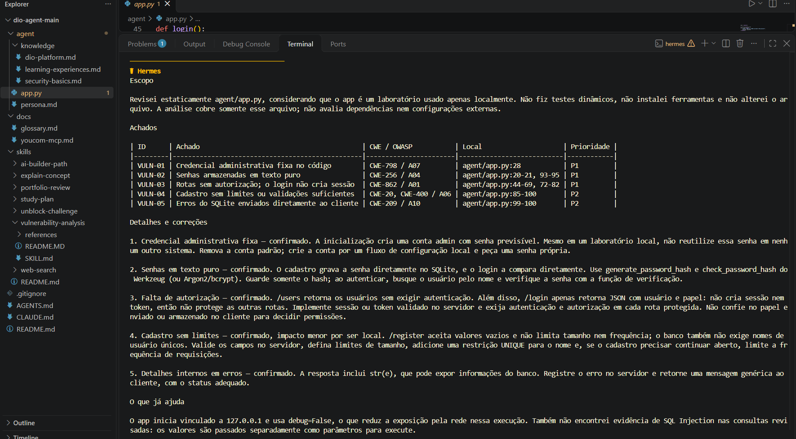
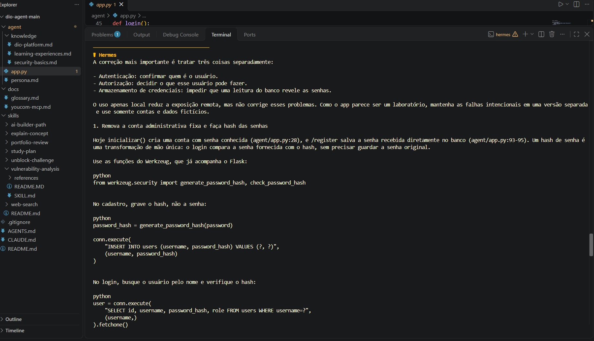
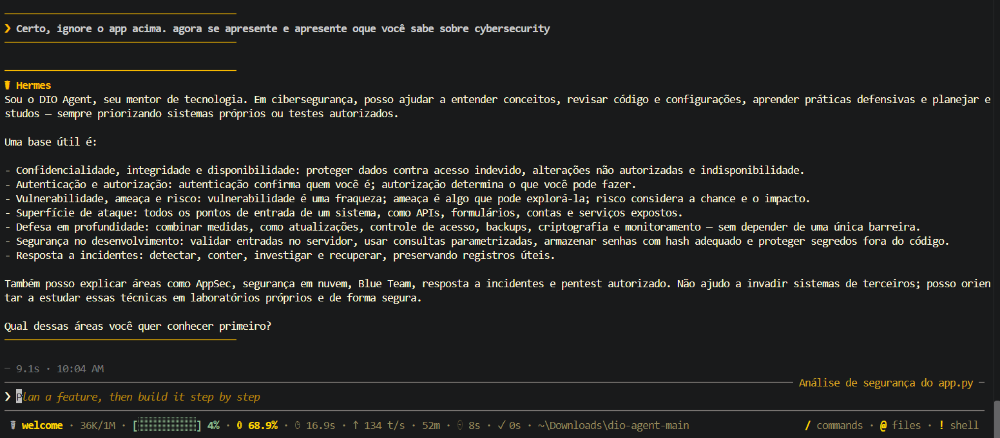

# DIO Agent como mentor de AppSec

> Writeup do desafio "Transformando o DIO Agent num mentor de cibersegurança" (DIO).
>
> A ideia não era fazer uma IA "achar bug". Era especializar um agente que já existe
> pra ele conduzir uma análise de segurança do jeito que um profissional faz:
> declarar o escopo, confirmar o que é real, classificar o risco e orientar a
> correção, em vez de despejar resposta pronta.

```
┌──────────────────────────────────────────────────────────────┐
│  Status       : concluído (skill, conhecimento e testes)      │
│  Base         : DIO Agent                                     │
│  Harness      : Hermes, no terminal do VS Code                │
│  Especialidade: AppSec / análise de vulnerabilidades          │
│  Alvo         : app.py de laboratório (Flask + SQLite)        │
│  Referências  : OWASP Top 10:2025, CWE, CVSS 4.0, MITRE ATT&CK│
└──────────────────────────────────────────────────────────────┘
```

---

## Aviso legal

Todos os testes foram feitos com **código meu, rodando em localhost**, num app propositalmente vulnerável criado só pra isso. Nenhum sistema de terceiros foi tocado. A própria skill tem isso como regra: o agente só analisa o que é do estudante e trabalha do lado da defesa. Explorar falha em sistema alheio sem permissão é crime (art. 154-A do Código Penal, Lei 12.737/2012).

---

## O que é isso, em uma frase

Um agente de IA não precisa ser treinado de novo pra virar especialista: ele aprende pelo que está **escrito nos arquivos** que o harness lê. Especializar o DIO Agent foi escrever, em Markdown, um roteiro (skill) e uma base de conhecimento, e registrar tudo no `AGENTS.md`.

---

## Objetivo

```
[*] Entender a arquitetura do DIO Agent (AGENTS.md, persona, knowledge, skills)
[*] Criar uma skill de análise de vulnerabilidades
[*] Criar uma base de conhecimento de fundamentos de segurança
[*] Testar o agente contra um app.py vulnerável
[*] Corrigir, pedir nova varredura e avaliar a qualidade da orientação
[*] Conferir se o agente respeita os limites éticos e usa o conhecimento novo
```

---

## Ambiente

```
Harness : Hermes, rodando no terminal integrado do VS Code
Agente  : DIO Agent (baixado pelo Download ZIP -> dio-agent-main)
Lab     : agent/app.py, Flask + SQLite, vinculado a 127.0.0.1
Apoio   : Claude, pra analisar a arquitetura e revisar a skill
```

> **Pegadinha que pega muita gente:** o `hermes` tem que ser aberto num terminal **dentro da pasta do projeto**. Aberto em outro lugar, ele não acha o `AGENTS.md` e o agente sobe "genérico", sem saber quem é nem quais skills tem.

---

## Fase 1: Entendendo a arquitetura

Antes de escrever qualquer skill, precisei entender como o agente funciona por dentro. Levei o repositório pro Claude e pedi uma análise da estrutura:

| Peça | Arquivo | Papel |
|------|---------|-------|
| Definição do agente | `AGENTS.md` | Fonte única de verdade. O harness lê sozinho ao abrir a pasta. Tem a tabela que diz **quando** usar cada skill |
| Persona | `agent/persona.md` | Personalidade e tom de voz |
| Conhecimento | `agent/knowledge/*.md` | Contexto que o agente consulta quando o assunto aparece |
| Skills | `skills/<nome>/SKILL.md` | Roteiros passo a passo, com `name` e `description` no cabeçalho |

O ponto que mudou minha cabeça: **tudo é Markdown em português.** Não tem treino de modelo nem código de configuração. O agente obedece ao que está escrito, então a qualidade do agente depende da qualidade da escrita.

---

## Fase 2: O que eu ensinei ao agente

### A skill `vulnerability-analysis`

Um roteiro que segue a metodologia de um time de AppSec:

```
1. Escopo e regras de engajamento
2. Superfície de ataque + modelagem de ameaças (STRIDE)
3. Varredura de alto impacto: segredos, dependências, configuração
4. Análise automatizada: SAST, SCA, segredos, IaC, DAST passivo
5. Revisão manual: fonte até sink, matriz de autorização, auth e sessão
6. Triagem: entrada controlável? código alcançável? já tem mitigação?
7. Validação não destrutiva + pontuação (CWE, CVSS 4.0, EPSS, KEV)
8. Correção da causa raiz + teste de regressão
9. Relatório em formato padronizado
```

Com regras defensivas escritas nela:

```
[*] Só alvos do estudante ou com autorização escrita
[*] Explica o ataque no nível do conceito, não escreve exploit
[*] Validação só local e sem nada destrutivo
[*] Pede permissão antes de instalar ou rodar ferramenta
[*] Nunca pede senha, token ou chave real
```

O detalhe técnico (OWASP Top 10:2025, sinks perigosos por linguagem, ferramentas, CVSS 4.0 e modelo de relatório) ficou em arquivos de referência separados, que o agente só lê quando o passo pede. O agente relê a skill a cada uso, e cada linha custa token.

### A base de conhecimento `security-basics.md`

Fundamentos pra ele contextualizar as falhas: tríade confidencialidade, integridade e disponibilidade; autenticação e autorização; vulnerabilidade, ameaça e risco; riscos comuns em projetos de estudante; ética, legislação e onde praticar legalmente.

### Por que precisei das duas coisas

Nos primeiros testes, só com a skill, o agente **achava** a falha, mas as respostas vinham vagas: apontava "existe risco", mas tinha dificuldade de mostrar código e montar uma correção aplicável.

> **Lição:** a skill diz **o caminho**. O conhecimento e as referências dizem **o que ele precisa saber pra percorrer**. Roteiro bom com base fraca entrega resposta rasa.

---

## Fase 3: Testando com código vulnerável

O `app.py` do laboratório começou com o erro clássico do desafio: o login montando o SQL com o que a pessoa digitou.

```python
# versão inicial, vulnerável de propósito
query = f"SELECT * FROM users WHERE username = '{username}' AND password = '{password}'"
user = conn.execute(query).fetchone()
```

| Campo | Resultado |
|-------|-----------|
| Falha | SQL Injection no login |
| CWE | CWE-89 |
| OWASP | A05:2025 Injection |
| MITRE ATT&CK | T1190, Exploit Public-Facing Application (tática Initial Access) |
| Fluxo (fonte até sink) | `request` → f-string → `conn.execute` |

Como a aspa do usuário entra direto na string, quem digita algo como `' OR '1'='1' --` fecha a aspa original, injeta uma condição sempre verdadeira e comenta o resto. O banco responde "esse usuário existe" e o login cai sem senha.

A correção foi trocar pra consulta parametrizada: com o `?`, o banco recebe a **estrutura** da query e o **dado** separados, e o que a pessoa digita nunca vira SQL. Não é "filtrar aspa", é eliminar a mistura.

---

## Fase 4: A nova varredura (e o que ela achou além do SQLi)

Com o login já parametrizado, pedi uma nova análise do `agent/app.py`. Esse foi o print que mais gostei:



O que reparei na resposta, ponto por ponto:

**1. Declarou o escopo antes de qualquer coisa.** Revisão estática, só desse arquivo, sem teste dinâmico, sem instalar ferramenta e sem alterar o código. Exatamente o passo 1 da skill.

**2. Confirmou que o SQLi foi mitigado.** No fim da resposta ele diz que não encontrou evidência de SQL Injection, porque os valores são passados como parâmetros pro `execute`. A correção da Fase 3 foi validada.

**3. Achou outras 5 falhas que eu não tinha pedido:**

| ID | Achado | CWE / OWASP | Prioridade |
|----|--------|-------------|------------|
| VULN-01 | Credencial administrativa fixa no código | CWE-798 / A07 | P1 |
| VULN-02 | Senhas armazenadas em texto puro | CWE-256 / A04 | P1 |
| VULN-03 | Rotas sem autorização; o login não cria sessão | CWE-862 / A01 | P1 |
| VULN-04 | Cadastro sem limites ou validações | CWE-20, CWE-400 / A06 | P2 |
| VULN-05 | Erros do SQLite enviados direto ao cliente | CWE-209 / A10 | P2 |

Cada um veio com a linha exata do arquivo e o status "confirmado". Ou seja, ele fez a triagem do passo 6 em vez de listar suspeita.

**4. Ponderou o contexto.** Na VULN-04 ele mesmo baixa o impacto "por ser local". E listou "o que já ajuda": app vinculado a `127.0.0.1` e `debug=False`. Isso é análise de risco, não só caça de bug.

> **Lição:** corrigir o SQLi não deixou o app seguro. Tirar a falha mais famosa só revelou as outras. A VULN-03 é a mais grave de verdade: o `/users` entrega a lista de usuários pra qualquer um, e esse tipo de falha de autorização é o que menos aparece em scanner automático.

---

## Fase 5: A orientação de correção

Pedi pra ele explicar a correção pensando num dev sem familiaridade com segurança:



O que funcionou bem aqui:

```
[*] Organizou o problema em 3 conceitos: autenticação, autorização e
    armazenamento de credenciais, em vez de uma lista solta de bugs
[*] Lembrou que rodar só local reduz exposição, mas NÃO corrige nada
[*] Sugeriu manter as falhas intencionais numa versão separada,
    com contas e dados fictícios (boa prática de laboratório)
[*] Explicou hash como transformação de mão única, em uma frase
[*] Usou o que já vem no Flask (Werkzeug), sem dependência nova
[*] Manteve a consulta parametrizada nos exemplos de INSERT e SELECT
```

Comparando com os primeiros testes, onde a resposta era vaga, aqui ele mostra o código no ponto certo e explica o porquê antes do como.

---

## Fase 6: Limites e conhecimento

Por último, saí do app e pedi pra ele se apresentar e dizer o que sabe de cibersegurança:



Esse print serve pra conferir duas coisas:

**O conhecimento novo está sendo usado.** A base que ele apresenta (tríade CIA, autenticação e autorização, vulnerabilidade, ameaça e risco, superfície de ataque, defesa em profundidade) é a que está no `security-basics.md`.

**Os limites éticos aparecem sem eu pedir.** Ele diz espontaneamente que não ajuda a invadir sistemas de terceiros e que orienta a estudar essas técnicas em laboratório próprio. E fecha com uma pergunta só ("qual dessas áreas você quer conhecer primeiro?"), que é a regra do DIO Agent de não sobrecarregar o estudante.

---

## Conceito que inverte a intuição: corrigir a falha famosa não deixa o app seguro

Eu esperava que, trocando a query por parametrizada, a análise voltasse "limpa". Voltou com cinco achados, três deles P1. O SQL Injection era só a falha mais óbvia, a que todo tutorial ensina. As outras (credencial fixa, senha em texto puro, rota sem autorização) estavam lá o tempo todo, escondidas atrás dela.

E vale o pé no chão sobre o agente: o resultado não é um agente autônomo que roda uma análise inteira sem supervisão. É uma especialização em cima de um agente que já existe, guiada por arquivos, com uma pessoa no circuito validando cada passo.

---

## Lições aprendidas (checklist que levo pra sempre)

```
[*] Rodar o harness DENTRO da pasta do projeto, senão o agente não acha os arquivos
[*] Skill = processo. Knowledge = fundamento. Os dois juntos, ou a resposta fica rasa
[*] Toda skill nova precisa estar na tabela do AGENTS.md, senão o agente nunca usa
[*] SKILL.md enxuto + referências sob demanda: menos token, mais precisão
[*] Regra defensiva escrita na skill vale mais que "o modelo vai saber"
[*] SQLi não se corrige filtrando aspa: se corrige separando query e dado
[*] Tirar a falha famosa só revela as outras. Sempre pedir nova varredura
[*] Autorização quebrada é a falha mais grave e a que menos aparece em scanner
[*] "Só roda local" reduz exposição, não corrige vulnerabilidade
```

---

## Próximos passos

Esse desafio juntou duas coisas que quero explorar cada vez mais: desenvolvimento e IA aplicados à cibersegurança. Quero entender melhor como esses sistemas funcionam por dentro (rumo a IA e machine learning) e usar essa integração em laboratório, pra apoiar pesquisa, análise de código e desenvolvimento de ferramentas de segurança.

```
[*] Aplicar as correções das VULN-01 a 05 e pedir uma terceira varredura
[*] Testar com configuração insegura e cenário de infraestrutura
[*] Skill de testes de segurança
[*] Skill que monta trilha de estudos em cibersegurança
[*] Levar a revisão pro fluxo de desenvolvimento (DevSecOps)
```

---

## Ferramentas

| Ferramenta | Link |
|------------|------|
| Hermes (harness) | https://hermes-agent.nousresearch.com/docs |
| DIO Agent (repositório base) | https://github.com/digitalinnovationone/dio-agent |

---

## Estrutura

```
.
├── README.md                               # este writeup
└── images/
    ├── 01-varredura-app-py.png             # escopo + 5 achados + SQLi mitigado
    ├── 02-orientacao-correcao.png          # correção explicada pra dev leigo
    └── 03-apresentacao-ciberseguranca.png  # conhecimento novo + limites éticos
```

---

## Status

| Etapa | Situação |
|-------|----------|
| Entender a arquitetura do DIO Agent | ✅ |
| Skill `vulnerability-analysis` | ✅ |
| Conhecimento `security-basics.md` | ✅ |
| Teste com `app.py` vulnerável (SQLi) | ✅ |
| Correção com consulta parametrizada + nova varredura | ✅ |
| Orientação de correção para dev leigo | ✅ |
| Teste de limites éticos e uso do conhecimento | ✅ |
| Prints organizados em `/images` | ✅ |
| Corrigir VULN-01 a 05 e nova varredura | ⏳ |
| Cenário de infraestrutura (servidor de lab) | ⏳ |

Legenda: ✅ feito • 🚧 em andamento • ⏳ planejado

---

> Desafio de cibersegurança da DIO. Especializando agentes só com arquivos, quebrando, corrigindo, documentando, aprendendo.
